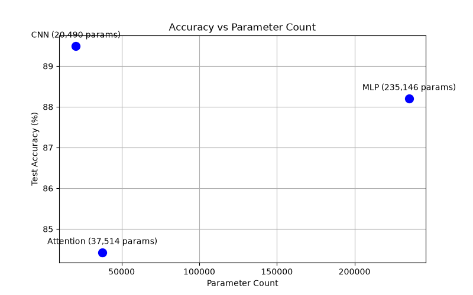
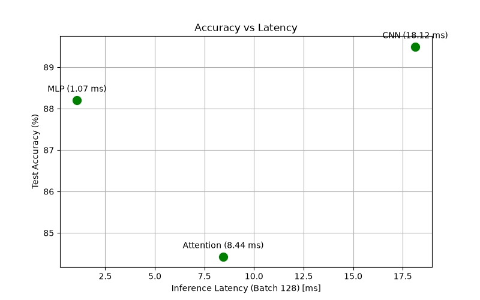

# Lab 3: Architectures and their Costs

**Student ID:** 72014

## 1. Architectural Specifications & FLOPs Analysis

### 1.1 Theoretical Layer Calculations
Based on Reddi Chapter 4 formulas, the theoretical FLOPs for a single layer of each architecture type are isolated below:

*   **MLP (Linear Layer: 784 $\rightarrow$ 256):**
    *   Formula: $2 \times \text{in} \times \text{out}$
    *   Calculation: $2 \times 784 \times 256 = 401,408$ FLOPs
*   **CNN (First Conv2d: 1 $\rightarrow$ 16, $3 \times 3$ kernel, padding=1):**
    *   Formula: $2 \times K \times K \times C_{\text{in}} \times C_{\text{out}} \times H_{\text{out}} \times W_{\text{out}}$
    *   Calculation: $2 \times 3 \times 3 \times 1 \times 16 \times 28 \times 28 = 225,792$ FLOPs
*   **Attention (QKV Projections & Attention Scores for 16 patches, $d_{\text{model}}=64$):**
    *   QKV Projections: $2 \times \text{seq} \times d_{\text{model}} \times 3 \times d_{\text{model}}$
    *   QKV Calculation: $2 \times 16 \times 64 \times 3 \times 64 = 393,216$ FLOPs
    *   Attention Scores: $2 \times \text{seq}^2 \times d_{\text{model}}$
    *   Scores Calculation: $2 \times 16^2 \times 64 = 32,768$ FLOPs

### 1.2 Empirical Profiling Results
The table below aggregates the complete forward-pass profiling metrics generated by `torchinfo` and `thop.profile`, alongside the benchmarked inference latencies and final test accuracies after 5 epochs on Fashion-MNIST.

| Architecture | Total Params | THOP FLOPs | Latency (Batch 1) | Latency (Batch 128) | Test Accuracy |
| :--- | :--- | :--- | :--- | :--- | :--- |
| **MLP** | 235,146 | 469,504 | 0.131 ms | 1.071 ms | 88.21% |
| **CNN** | 20,490 | 2,063,488 | 0.620 ms | 18.124 ms | 89.50% |
| **Attention** | 70,794 | 1,182,976 | 1.220 ms | 8.442 ms | 84.43% |

### 1.3 Analytical Gap in FLOPs Measurement
The mathematical formulas compute operations for isolated core matrix multiplications within a single layer. The `thop` measurements record the entirety of the network's forward pass. This introduces a substantial numerical gap because `thop` captures implicit operations ignored by basic formulas, including:
*   Bias vector additions across all layers.
*   Activation functions (e.g., ReLU non-linearities).
*   Pooling operations (MaxPool2d in the CNN and sequence mean-pooling in the Attention model).
*   Structural reshaping, permuting, and flattening operations.

Additionally, `thop` calculates FLOPs by multiplying measured MACs (Multiply-Accumulates) by a factor of 2, serving as a hardware-level estimation rather than a strict theoretical count.

---

## 2. Performance Trade-Off Visualizations

The following graphs map the structural costs of each architecture against its predictive performance.

### Figure 2.1: Model Accuracy vs. Parameter Footprint

> *Observation:* The MLP relies on brute-force memorization, consuming 235k parameters (over 11x the CNN) yet failing to surpass the CNN's accuracy. The CNN achieves the highest accuracy with the smallest memory footprint (20.4k params), demonstrating highly efficient spatial feature extraction.

### Figure 2.2: Model Accuracy vs. Inference Latency (Batch 128)

> *Observation:* While the CNN achieves peak accuracy, it requires the highest execution time at scale (18.124 ms for Batch 128) due to the sequential depth of sliding-window convolutions. The MLP processes the same batch in just 1.071 ms, highlighting a direct trade-off between predictive accuracy and raw throughput.

---

## 3. Hardware Access Patterns & Cost-Effectiveness

Evaluating the architectures through the lens of hardware access patterns (Reddi Ch. 4.6–4.7) reveals that **the CNN is the most cost-effective architecture** for this spatial task, despite its higher latency.

### Convolutional Neural Network (Compute-Bound)
The CNN achieves 89.50% accuracy using only 20,490 parameters. This extreme efficiency is driven by a **sliding-window access pattern**. Filter weights are reused sequentially across the $H \times W$ spatial dimensions of the input. Because the parameter footprint is tiny, the hardware can pin the weights in fast, on-chip SRAM cache, practically eliminating DRAM fetches during inference. The workload is highly **compute-bound**; the processor spends its cycles doing math (over 2 million FLOPs) rather than waiting for memory, extracting maximum value per parameter.

### Multi-Layer Perceptron (Memory-Bound)
The MLP exhibits the